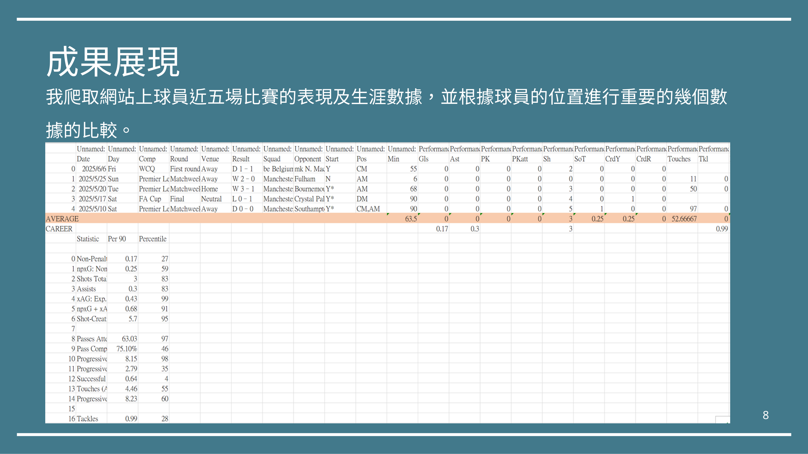
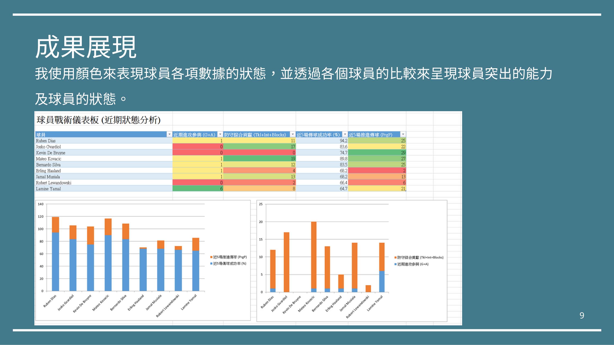
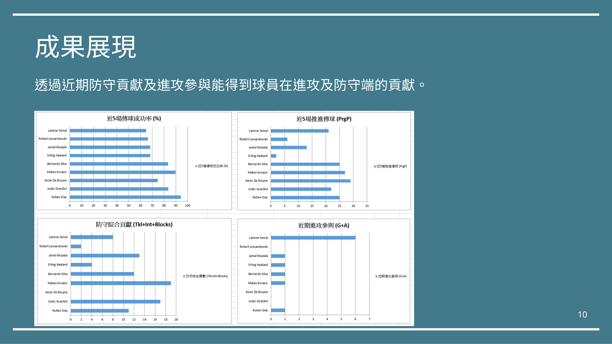

# ⚽ 當足球熱情遇上程式碼 —— FBref 球員數據分析與視覺化儀表板
> **FBref Football Player Data Analytics & Automated Dashboard**  
> 🏆 **國立花蓮高級中學 113 學年度第二學期自主學習成果評選「成果獎狀（表現優異）」**  
> 👤 **作者 / 開發者：葉陽甫 (Yeh Yang-Fu)**

---

## 📌 專案目錄 (Table of Contents)
- [專案動機與背景](#-專案動機與背景)
- [核心功能特色](#-核心功能特色)
- [系統架構與資料處理流程](#-系統架構與資料處理流程)
- [關鍵工程挑戰與核心反思 (Rate Limiting 除錯)](#-關鍵工程挑戰與核心反思-rate-limiting-除錯)
- [成果展示與視覺化儀表板](#-成果展示與視覺化儀表板)
- [專案檔案結構](#-專案檔案結構)
- [快速開始 (Quick Start)](#-快速開始-quick-start)
- [佐證文件與報告](#-佐證文件與報告)

---

## 💡 專案動機與背景

作為一名高中五人制足球校隊選手（曾代表花蓮高中榮獲全國中等學校五人制足球聯賽全國第 5 名與第 6 名），同時也是資深足球迷與 eFootball 玩家，我經常和隊友與朋友們為了**「某位球員近期狀態是好是壞」**、**「該球員在場上的戰術定位與攻防貢獻」**爭論不休。

然而，彼此憑主觀感覺的爭論往往難以凝聚共識。於是我萌生了一個想法：  
> **「與其憑主觀感覺爭辯，能不能用真實、客觀的數據來終結爭論？」**

這個想法結合了我對 Python 程式設計與資料科學的強烈興趣，促成了這個自主學習專案：**親手打造一套能自動擷取世界頂尖足球數據庫 [FBref](https://fbref.com/) 資料的網路爬蟲，並透過資料清洗與演算法計算，自動化生成 Excel 視覺化分析儀表板**。

---

## 🚀 核心功能特色

1. **自動化批次數據擷取**：
   - 以 Python 自動解析 FBref 網頁架構，精準抓取球員**「近五場比賽詳細數據」**與**「整個職業生涯的重要統計」**。
2. **多維度球員狀態分析**：
   - 涵蓋出場時間、進球、助攻、預期進球（xG）、預期助攻（xAG）、傳球成功率、防守阻截、對抗成功等 40+ 項細部指標。
3. **動態 Excel 視覺化儀表板（xlwings 整合）**：
   - 結合 `pandas` 與 `xlwings`，程式自動將清洗後的數據即時寫入 Excel。
   - 利用條件式格式設定（色階熱力分析），一秒判讀球員各項數值相較平均的起伏。
4. **戰術定位與攻防貢獻模型**：
   - 繪製**四象限戰術定位散布圖**（進攻參與度 vs. 防守貢獻度），清晰界定球員是偏向「純進攻箭頭」、「全能中場」或「防守盾牌」。

---

## 🛠️ 系統架構與資料處理流程


1. **輸入層**：於 Excel 設定球員名稱及對應的 FBref 頁面網址。
2. **採集層**：利用 `pandas.read_html()` 與解析腳本，解析 FBref 複雜的多層表頭表格。
3. **清洗層**：截取關鍵特徵欄位（例如 iloc 欄位過濾），移除冗餘標籤與空值。
4. **展現層**：透過 `xlwings` 操控 Excel 物件模型，自動產出含色階統計與戰術圖表的分析頁。

---

## 🧠 關鍵工程挑戰與核心反思 (Rate Limiting 除錯)

這項專題中最寶貴的收穫，並非一帆風順的程式碼，而是**在遭遇系統挫折時的排查與工程思維轉變**：

### 1. 效率優化的代價：意外觸發反爬機制
在成功抓取單一球員數據後，為了追求效率，我將程式改為迴圈連續抓取多位球員。程式短時間內發出了密集的大量 HTTP 請求，不到一分鐘便被 FBref 伺服器判定為惡意爬蟲，**IP 位址隨即遭網站封鎖（Rate Limiting / HTTP 429）**。

### 2. 治標的嘗試 vs. 根本問題
起初，我使用 VPN 切換 IP 位址，程式確實重新跑通。但我發現隔天新的 IP 同樣面臨被封鎖的風險。這讓我停下腳步反思：  
> **「依賴不斷更換 IP 只是治標；問題的本質在於我的請求方式對伺服器造成了不合理的負擔。」**

### 3. 根本解法：理解網路爬蟲禮儀與工程規範
我進一步查閱網路規範與開源文獻，深入理解了**「速率限制（Rate Limiting）」**與**「網路爬蟲倫理」**：
- **請求節流（Throttling）**：在每次請求之間加入適當延遲（如 `time.sleep(3)`），模擬合理人類瀏覽行為。
- **尊重伺服器承載能力**：設計友善的爬取策略，不貪求毫秒級並發，而是追求系統的長期穩定與永續運行。

> **💡 核心心得**：  
> **「能把程式跑起來還不夠，更必須理解底層系統限制與協定規範。一名優秀的工程師，不應只求快速繞過問題，而應追求穩定且負責任的根本解法。」**

---

## 📊 成果展示與視覺化儀表板

### 1. 球員近五場比賽與生涯數據比較
以曼城（Manchester City）球員為例，擷取真實數據並自動分類對齊：


### 2. 色階熱力圖分析球員突出能力
透過色階輔助視覺化，迅速對比球員近期狀態是處於高峰期還是低潮期：


### 3. 攻防貢獻比對與戰術定位
透過量化計算「防守阻截」與「進攻創造」，直觀呈現球員在戰術體系中的實際定位：


---

## 📂 專案檔案結構

```text
fbref-player-analysis/
├── docs/                                    # 專題相關文件與圖檔
│   ├── images/                              # README 與報告截圖
│   │   ├── project_cover.png
│   │   ├── result_page_8.png
│   │   ├── result_page_9.png
│   │   └── result_page_10.png
│   ├── 04_FBref_亮點佐證.pdf                 # 大學特殊選材／個人亮點簡報
│   └── 自主學習報告_當足球熱情遇上程式碼.pdf     # 完整自主學習結案報告書 (13頁)
├── dashboard_generator.py                   # 儀表板生成器核心程式 (v8.4 戰術分析版)
├── man city code.py                         # 曼城球員 FBref 批次爬取腳本
├── Pandas.py                                # 初期原型測試腳本 (單一球員抓取)
├── sofascoretest.py                         # 跨平台數據來源測試腳本
├── man city player.xlsx                     # 球員網址名單與基礎設定檔
├── man city player_DashBorad.xlsx           # 最終生成的球員分析儀表板 (含圖表)
├── test.xlsx                                # 測試與調校用資料表
├── requirements.txt                         # 專案依賴套件清單
├── .gitignore                               # Git 忽略設定
└── README.md                                # 本專案說明文件
```

---

## 💻 快速開始 (Quick Start)

### 1. 安裝環境依賴
建議使用 Python 3.10+ 環境：
```bash
git clone https://github.com/yyfsunnyboy/fbref-player-analysis.git
cd fbref-player-analysis
pip install -r requirements.txt
```

> **注意**：本專案使用 `xlwings` 與本機 Microsoft Excel 互動，執行時需確保電腦已安裝 Microsoft Excel。

### 2. 執行爬蟲與數據收集
```bash
python "man city code.py"
```

### 3. 自動生成視覺化儀表板
```bash
python dashboard_generator.py
```
執行完畢後，開啟 `man city player_DashBorad.xlsx` 即可查看動態生成的色階熱力分析與戰術象限圖！

---

## 📑 佐證文件與報告

- 📄 **完整專題成果報告書**：[點此檢視 PDF (13頁完整版)](docs/自主學習報告_當足球熱情遇上程式碼.pdf)
- 📄 **特殊選材精華佐證**：[點此檢視 PDF (亮點單頁版)](docs/04_FBref_亮點佐證.pdf)
- 🏅 **獲獎紀錄**：國立花蓮高級中學 113 學年度第二學期自主學習成果評選 - 成果獎狀（表現優異）
